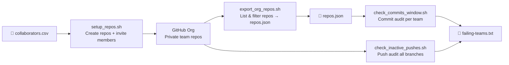

# 🏆 hackathon-tools

> Bash automation scripts for spinning up GitHub team repositories and monitoring participant activity during hackathon checkpoints — works with **any GitHub organization**.

[](LICENSE)
[](https://www.gnu.org/software/bash/)
[](https://cli.github.com/)
[](https://stedolan.github.io/jq/)

---

## ✨ Features

- **Zero hardcoding** — every script is driven by CLI arguments; no editing files between events
- **Organization-agnostic** — works with any GitHub org or personal account
- **Checkpoint-ready** — run commit or push audits against a precise time window in seconds
- **Timezone-aware** — specify local times in any IANA timezone; UTC conversion is automatic
- **Midnight-crossing** — works correctly when a checkpoint spans two calendar days
- **Cross-platform** — GNU (Linux) and BSD (macOS) `date` both supported
- **Self-documenting** — every script has a `--help` flag

---

## 📋 Prerequisites

| Tool | Install |
| :--- | :--- |
| [GitHub CLI (`gh`)](https://cli.github.com/) ≥ 2.x | `brew install gh` · `winget install gh` · [Linux packages](https://github.com/cli/cli/blob/trunk/docs/install_linux.md) |
| [`jq`](https://stedolan.github.io/jq/) | `brew install jq` · `apt install jq` · `winget install jqlang.jq` |
| Bash ≥ 4.x | Shipped on Linux; macOS users: `brew install bash` |

**Authentication** — log in once before running any script:

```bash
gh auth login
```

---

## 🗂 Repository Layout

```
hackathon-tools/
├── scripts/
│   ├── setup_repos.sh           # Provision team repos + invite members
│   ├── export_org_repos.sh      # Export org repo list → repos.json
│   ├── check_commits_window.sh  # Audit commits per team in a time window
│   └── check_inactive_pushes.sh # Audit push events per repo in a time window
├── examples/
│   ├── collaborators.csv        # Sample input for setup_repos.sh
│   └── repos.json               # Sample output of export_org_repos.sh
├── CONTRIBUTING.md
├── CHANGELOG.md
└── LICENSE
```

---

## 🚀 Quick Start

```bash
# 1. Clone
git clone https://github.com/your-org/hackathon-tools.git
cd hackathon-tools

# 2. Make scripts executable
chmod +x scripts/*.sh

# 3. Authenticate with GitHub
gh auth login

# 4. Create team repos from CSV
./scripts/setup_repos.sh -o my-hackathon-org -f examples/collaborators.csv

# 5. Export the repo list for the checkers
./scripts/export_org_repos.sh my-hackathon-org --prefix team- -f repos.json

# 6. Run a checkpoint audit
./scripts/check_commits_window.sh repos.json 13:30 16:30 -o my-hackathon-org --tz Asia/Kolkata
```

---

## 🔄 Typical Workflow



---

## 📖 Script Reference

### `setup_repos.sh` — Provision repos & invite members

Creates private repositories for every team listed in a CSV, then invites each member as a collaborator.

#### CSV Format

The CSV has no header row. Team name is the first column; usernames follow. Commas **and** semicolons are both accepted as delimiters, and you can mix formats freely:

```csv
team-alpha,alice-dev,bob-codes,charlie42
team-beta,diana-gh;evan-hacks;fiona-build
team-gamma,george-dev
team-gamma,harriet-coder   ← same team on multiple lines is fine
```

See [`examples/collaborators.csv`](examples/collaborators.csv) for a full sample.

#### Usage

```
./scripts/setup_repos.sh [-o ORG] [-f CSV_FILE] [-p PERMISSION]

  -o ORG        GitHub org to create repos in  (default: authenticated user)
  -f CSV_FILE   Path to the collaborators CSV   (default: collaborators.csv)
  -p PERMISSION read | triage | write | maintain | admin  (default: maintain)
  -h, --help    Show this help

Environment:
  CREATE_IF_MISSING=0   Skip repo creation; only send invites
```

#### Examples

```bash
# Create repos + invite all members
./scripts/setup_repos.sh -o my-org -f examples/collaborators.csv

# Use write permission instead of maintain
./scripts/setup_repos.sh -o my-org -f examples/collaborators.csv -p write

# Re-send invites without re-creating repos
CREATE_IF_MISSING=0 ./scripts/setup_repos.sh -o my-org -f examples/collaborators.csv
```

---

### `export_org_repos.sh` — Export org repo list to JSON

Queries a GitHub organization and writes all matching repos to a JSON file that the checkers can consume.

#### Output Format

```json
{
  "team-alpha": [],
  "team-beta":  [],
  "team-gamma": []
}
```

With `--members`, the arrays are populated with collaborator logins.

#### Usage

```
./scripts/export_org_repos.sh [ORG] [-f OUTPUT] [--prefix STR] [--exclude REGEX]
                              [--members] [--include-archived] [--include-forks] [--force]

  ORG                 GitHub org / user (default: authenticated user)
  -f OUTPUT           Output file path         (default: repos.json)
  --prefix STR        Only repos starting with STR
  --exclude REGEX     Skip repos matching REGEX (ERE)
  --members           Fetch collaborators per repo (slower; one extra API call each)
  --include-archived  Include archived repos    (default: skip)
  --include-forks     Include forked repos      (default: skip)
  --force             Overwrite output file
  -h, --help          Show this help
```

#### Examples

```bash
# Basic export — all non-archived, non-fork repos
./scripts/export_org_repos.sh my-org -f repos.json

# Only repos with the "team-" prefix
./scripts/export_org_repos.sh my-org --prefix team- -f repos.json --force

# Exclude infra / template repos with a regex
./scripts/export_org_repos.sh my-org \
  --exclude '^(\.github|starter-template|infra-.*)$' \
  -f repos.json

# Also fetch member lists (much slower, one API call per repo)
./scripts/export_org_repos.sh my-org --members -f repos.json
```

---

### `check_commits_window.sh` — Commit-based checkpoint checker

Verifies that each team's **default branch** has at least one commit within a specified time window.

#### Output

```
Owner:  my-org
Window: 2026-10-18 13:30 IST  ->  2026-10-18 16:30 IST
(UTC:   2026-10-18T08:00:00Z  ->  2026-10-18T11:00:00Z)
------------------------------------------------
TEAM                           COMMITS  STATUS
team-alpha                           3  OK
team-beta                            0  NO COMMIT IN WINDOW
team-gamma                           -  MISSING/ERROR
------------------------------------------------
Total: 3 | Passed: 1 | Failed: 2
Failing teams logged to: teams_no_commit_2026-10-18-13-30_to_2026-10-18-16-30.txt
```

Exit codes: `0` = all passed · `2` = one or more teams failed

#### Usage

```
./scripts/check_commits_window.sh REPOS_JSON START END [-o OWNER] [-f OUTPUT] [--tz ZONE]

  REPOS_JSON    JSON file produced by export_org_repos.sh
  START         Window start — HH:MM  or  "YYYY-MM-DD HH:MM"  (24-hour)
  END           Window end   — HH:MM  or  "YYYY-MM-DD HH:MM"
  -o OWNER      GitHub org / user           (default: authenticated user)
  -f OUTPUT     Log file for failing teams  (default: auto-named)
  --tz ZONE     IANA timezone of START/END  (default: local machine timezone)
  -h, --help    Show this help
```

#### Examples

```bash
# Today's window, local timezone
./scripts/check_commits_window.sh repos.json 13:30 16:30 -o my-org

# Explicit timezone (organizer's machine may be elsewhere)
./scripts/check_commits_window.sh repos.json 13:30 16:30 -o my-org --tz Asia/Kolkata

# Specific date (useful for post-event audits)
./scripts/check_commits_window.sh repos.json "2026-10-18 13:30" "2026-10-18 16:30" -o my-org

# Window that crosses midnight
./scripts/check_commits_window.sh repos.json 22:00 01:00 -o my-org --tz UTC

# Pipe failing teams to another command
./scripts/check_commits_window.sh repos.json 13:30 16:30 -o my-org -f /tmp/out.txt
cat /tmp/out.txt | xargs -I{} gh issue create --repo my-org/{} --title "Missed checkpoint"
```

---

### `check_inactive_pushes.sh` — Push-based checkpoint checker

Identifies repos with **zero push events to any branch** during a time window, using GitHub's Activity API. Faster for broad audits since it does not need a pre-built JSON file.

#### When to use this vs `check_commits_window.sh`

| | `check_commits_window.sh` | `check_inactive_pushes.sh` |
| :--- | :---: | :---: |
| Data source | Commits API | Activity API |
| Branch scope | Default branch only | **All branches** |
| Input required | `repos.json` | Just the org name |
| Speed | ~1 req / team | ~1 req / repo |
| Best for | Verifying default-branch work | Quick broad sweep |

#### Output

```
Org:    my-org
Window: 2026-10-18 17:00 IST  ->  2026-10-18 18:30 IST
(UTC:   2026-10-18T11:30:00Z  ->  2026-10-18T13:00:00Z)
------------------------------------------------
REPO                           PUSHES  STATUS
team-alpha                          2  OK
team-beta                           0  NO PUSH IN WINDOW
team-gamma                          5  OK
------------------------------------------------
Total: 3 | Active: 2 | Inactive: 1
Inactive teams logged to: inactive-teams_2026-10-18-17-00_to_2026-10-18-18-30.txt
```

Exit codes: `0` = all active · `2` = one or more repos inactive

#### Usage

```
./scripts/check_inactive_pushes.sh ORG START END [-f OUTPUT] [--tz ZONE]

  ORG           GitHub org / user to audit
  START         Window start — HH:MM  or  "YYYY-MM-DD HH:MM"  (24-hour)
  END           Window end   — HH:MM  or  "YYYY-MM-DD HH:MM"
  -f OUTPUT     Log file for inactive repos  (default: auto-named)
  --tz ZONE     IANA timezone of START/END   (default: local machine timezone)
  -h, --help    Show this help
```

#### Examples

```bash
# Today's push audit
./scripts/check_inactive_pushes.sh my-org 17:00 18:30

# With timezone
./scripts/check_inactive_pushes.sh my-org 17:00 18:30 --tz Asia/Kolkata

# Specific date
./scripts/check_inactive_pushes.sh my-org "2026-10-18 17:00" "2026-10-18 18:30"

# Midnight-spanning window
./scripts/check_inactive_pushes.sh my-org 22:00 02:00 --tz America/New_York
```

---

## 💡 Common Patterns

### Full event lifecycle

```bash
ORG="hackathon-2026"
CSV="examples/collaborators.csv"

# ── Day 0: Provision ──────────────────────────────────────────────────────────
./scripts/setup_repos.sh -o "$ORG" -f "$CSV"
./scripts/export_org_repos.sh "$ORG" --prefix team- -f repos.json

# ── Checkpoint 1 (13:30–16:30 IST) ───────────────────────────────────────────
./scripts/check_commits_window.sh repos.json 13:30 16:30 -o "$ORG" --tz Asia/Kolkata

# ── Checkpoint 2 (17:00–18:30 IST) — quick push sweep ────────────────────────
./scripts/check_inactive_pushes.sh "$ORG" 17:00 18:30 --tz Asia/Kolkata

# ── Post-event audit for a specific date ─────────────────────────────────────
./scripts/check_commits_window.sh repos.json \
  "2026-10-18 09:00" "2026-10-18 18:00" -o "$ORG" --tz Asia/Kolkata
```

### Re-run invites without touching repos

```bash
# Only resend GitHub invites (no repo creation)
CREATE_IF_MISSING=0 ./scripts/setup_repos.sh -o "$ORG" -f "$CSV"
```

### Filter out infra repos before a checkpoint

```bash
./scripts/export_org_repos.sh "$ORG" \
  --exclude '^(\.github|template|infra-.*)$' \
  --prefix team- \
  -f repos.json --force
```

### Pipe failing teams to a Slack webhook

```bash
./scripts/check_inactive_pushes.sh "$ORG" 17:00 18:30 --tz Asia/Kolkata \
  -f /tmp/inactive.txt || \
  curl -s -X POST "$SLACK_WEBHOOK" \
    -H 'Content-type: application/json' \
    -d "{\"text\": \"Inactive teams:\n$(cat /tmp/inactive.txt)\"}"
```

---

## 🕐 Time Format Reference

All scripts that accept `START` / `END` support two formats:

| Format | Example | Notes |
| :--- | :--- | :--- |
| `HH:MM` | `13:30` | Treated as today's date. Dots work too: `13.30` |
| `"YYYY-MM-DD HH:MM"` | `"2026-10-18 13:30"` | Full date + time (quote the space) |

**Midnight-crossing windows:** when `END` is given as `HH:MM` and the parsed time is ≤ `START`, exactly 24 hours are added automatically — e.g. `22:00 01:00` becomes a 3-hour window starting at 22:00 and ending at 01:00 the next day.

---

## 🔍 Troubleshooting

| Symptom | Likely cause | Fix |
| :--- | :--- | :--- |
| `gh CLI not found` | gh not installed | [Install gh CLI](https://cli.github.com/) |
| `Run 'gh auth login' first` | Not authenticated | `gh auth login` |
| `jq not found` | jq not installed | `apt install jq` / `brew install jq` |
| `File not found: repos.json` | Wrong path | Check the path; run `export_org_repos.sh` first |
| All teams show `MISSING/ERROR` | Wrong `-o OWNER` or wrong org | Verify `gh repo list your-org` returns results |
| Times parsed incorrectly | Missing `--tz` flag | Pass `--tz` matching where your START/END times are relative to |
| `END must be after START` | Accidental same-day midnight cross | Specify full dates to be explicit: `"YYYY-MM-DD HH:MM"` |
| macOS date errors | Bash version < 4 on macOS | `brew install bash && exec bash` |

---

## 🤝 Contributing

Contributions are welcome! Please read [CONTRIBUTING.md](CONTRIBUTING.md) before opening a pull request.

---

## 📄 License

[MIT](LICENSE) © hackathon-tools contributors
